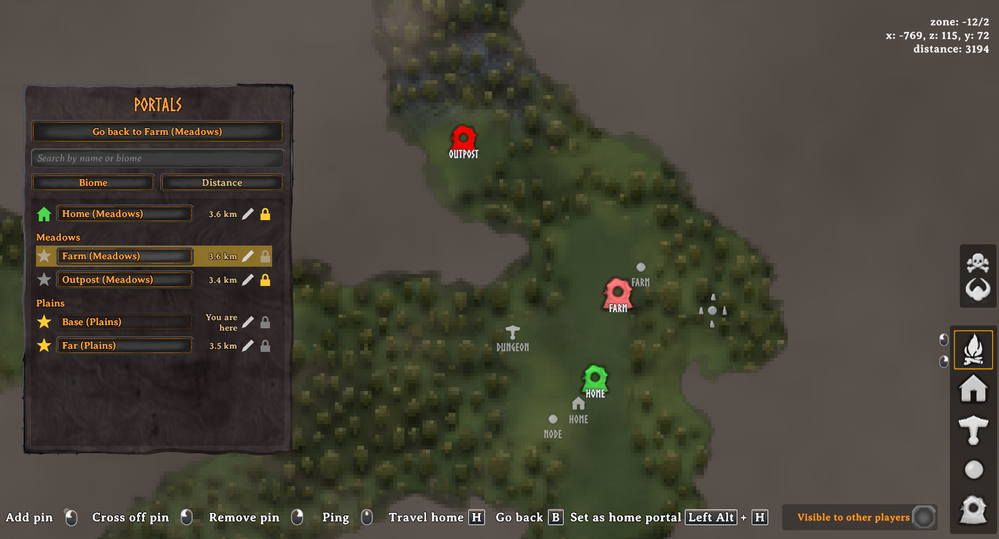

# PortalNetwork

Teleport to any portal through a map interface without tag linking. Search, group and rename portals, travel home or back with a key, and keep portals public or private.
To open the portal interface, walk into any portal.
To show/hide the portal icons on the map and minimap, open the map as normal and press `P` (configurable).

## The Portal List

Walking into a portal also opens a list of every portal you can travel to, next to the map.

- Hover over a portal in the list to make its icon on the map pulse, or over its icon on the map to light up its row in the list.
- Type in the search box to show only the portals whose name or biome matches.
- Use the **Biome** and **Distance** buttons to split the list into sections: a section per biome, a section for each set of portals near each other (such as one island's), or both, so the same biome in different parts of the world is listed apart.
- Click the star next to a portal to make it a favourite. Favourites come first in the list and have a gold ring on the map.
- Click the pencil next to a portal to rename it, even when it is far away. Anyone who can see a portal can rename it.
- The builder of a portal, and admins, can click the padlock next to it to lock its name, so only they can rename it, from the list or at the portal.

## Home Portal

Each world can have one **home portal**, shared by everyone.

- Admins, and the host of a self-hosted world, press `Alt + H` while looking at a portal, or with the portal map open, to make that portal the home portal. It becomes public, and can't be made private while it is home. Press `Alt + H` at the home portal to stop it being home.
- Press `H` while looking at any other portal, or with the portal map open, to travel straight home. Nothing happens if you're already at the home portal.
- The portal map's key hints show these keys whenever pressing them would do something.
- The home portal is green on the map and comes first in the portal list, with a house instead of the favourite star.
- If the home portal is destroyed, the previous home portal becomes home again, unless it was removed as home or made private.

## Going Back

Press `B` (configurable) while looking at a portal, or with the portal map open, to go back to the portal of your last trip, like the portal list's **Go back to** button. At the end of a trip, it takes you back where you came from.

## Pinging a Location

Press `P` (configurable) while walking around, with no map or menu open, to ping the spot you are looking at on everyone's map, or where you stand if you look at the sky. It's the same ping as clicking on the map, so other players can find you, or see what you mean, without you opening the map.

## Public and Private Portals

Every portal is **public** by default, so everyone can see and use it.

- `Shift + Use` on a portal you built toggles it between **public** and **private**.
- A private portal only appears on its builder's map. Anyone who walks into it can still use it to travel to the portals they can see.
- Hover over a portal to see its current visibility.

Admins, and the host of a self-hosted world, can see every portal and change any portal's visibility.

## Configuration

Settings are in the BepInEx config file `javidahmed64592.portalnetwork.cfg`.

## Compatibility

- Other mods that change how portals link or teleport (such as TargetPortal) replace the same behaviour, so only use one of them.
- The portal keys (`B`, `H`, `Alt + H`) may be bound by other mods too. When one does something at a portal or in the portal map, mods that read keys through the game's controls (such as Jotunn mods) don't also react to it; mods that read the keyboard directly still do, so change one of the keys if they clash.
- This mod has not been tested with a gamepad, only with keyboard and mouse. With a gamepad, move the map so a portal is under the crosshair and press the confirm button to travel there; the portal list needs a mouse.

## Uninstalling

Portals go back to vanilla linking, where two portals with the same name connect, so rename them in pairs to keep using them.
Whether a portal is public or private, whether its name is locked, and your favourites, stay saved but do nothing without the mod.

## License

This project is licensed under the MIT License - see the [LICENSE](https://github.com/javidahmed64592/Valheim-PortalNetwork/blob/main/LICENSE) file for details.
