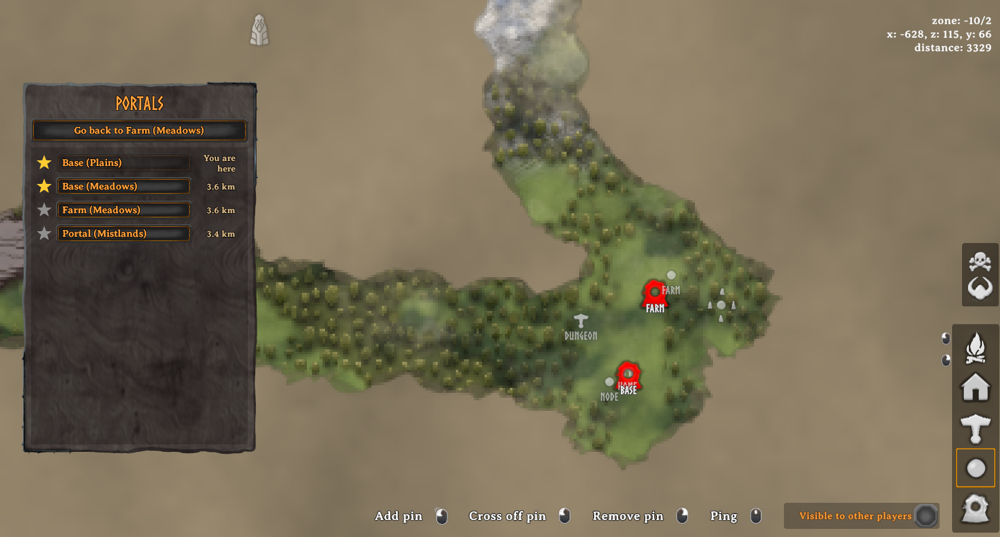

# PortalNetwork

Teleport to any portal through a map interface without tag linking.

## How to Use

1. **Build portals** as normal. Press **Use** on a portal to give it a name. Names are what you see on the map.
2. **Walk into a portal.** The large map opens with a pin on every portal you can use. Portal pins are drawn on top of all other map icons, and the other icons are faded so the portals stand out.
3. **Click a pin** to teleport there. To stay where you are, close the map (M or Esc). The map also closes automatically if you move more than 2 metres away from the portal.

### Portal List, Favourites and Going Back

On the left of the map, a list shows every portal you can use, with its biome and distance, e.g. **Home (Plains)**. Click a name to teleport there. The portal you are standing at is always first, marked **You are here**.

- Click the **star** next to a portal to make it a favourite. Favourites move to the top of the list, just below the portal you are at.
- **Go back to ...** at the top takes you to your last destination. If you are already there, it takes you back to where you came from, so you can go back and forth between two portals when moving materials.
- Favourites and your last trip are saved with your character, separately for each world.

### Showing Portals on the Map

Open the map normally and press **P** (configurable) to show or hide an icon for every portal you can use.

### Public and Private Portals

Every portal is **public** by default, so everyone can see and use it.

- **Shift + Use** on a portal you built toggles it between **public** and **private**.
- A private portal only appears on its builder's map.
- Hover over a portal to see its current visibility.

Admins, and the host of a self-hosted world, can see every portal and change any portal's visibility.

## Configuration

Settings are in the BepInEx config file `javidahmed64592.portalnetwork.cfg`.

## Credits

Inspired by [TargetPortal](https://thunderstore.io/c/valheim/p/Smoothbrain/TargetPortal/) by Smoothbrain.

## License

This project is licensed under the MIT License - see the [LICENSE](https://github.com/javidahmed64592/Valheim-PortalNetwork/blob/main/LICENSE) file for details.
